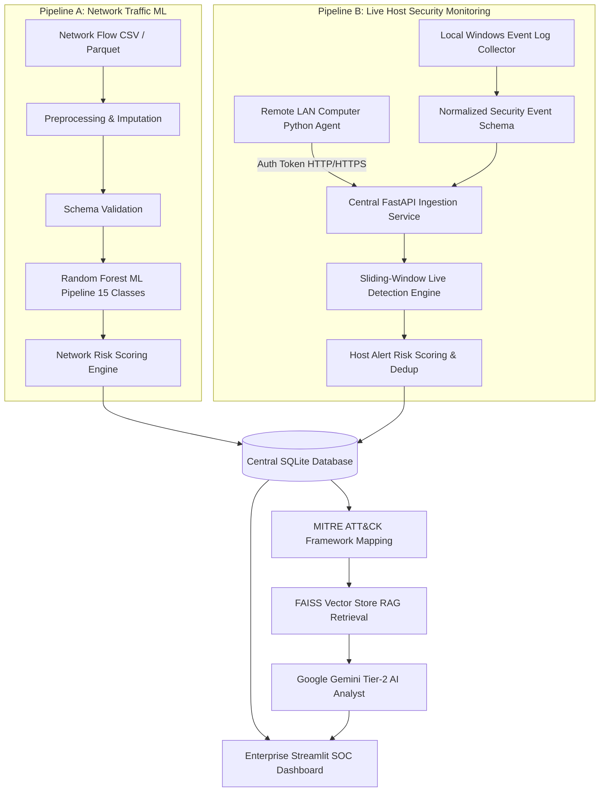

# 🛡️ AI-Powered Autonomous SOC Assistant
### Enterprise Security Operations Center Platform with Dual-Pipeline Detection: Machine Learning Network Threat Classification & Near-Real-Time Host Security Log Monitoring

[](https://www.python.org/)
[-orange.svg)](https://scikit-learn.org/)
[](https://fastapi.tiangolo.com/)
[](https://attack.mitre.org/)
[](https://aistudio.google.com/)
[](https://github.com/facebookresearch/faiss)
[](#automated-testing)

---

## 📌 Project Overview & Problem Statement

Modern Security Operations Centers (SOCs) face an overwhelming volume of daily security telemetry from both **perimeter network flows** and **endpoint host logs**. Tier-1 cybersecurity analysts face alert fatigue, manual correlation delays, and fragmented visibility across diverse data sources.

The **AI-Powered Autonomous SOC Assistant** is an enterprise-grade defensive cybersecurity platform engineered as a final-year B.Tech Data Science capstone project. It bridges two complementary defensive disciplines:

1. **Pipeline A: Offline / Batch Network Flow ML Threat Classification**  
   Ingests network flow telemetry (CIC-IDS2017 benchmark), cleans and validates data schemas, classifies multi-class attacks using an authentic **Random Forest Classifier (98.03% accuracy across 15 categories)**, and calculates transparent 0–100 risk scores.

2. **Pipeline B: Near-Real-Time Host Security Log Ingestion & Threat Detection**  
   A centralized streaming telemetry architecture powered by **FastAPI** that ingests authorized Windows Security Event Logs (Event IDs 4624, 4625, 4634, 4740) and Linux authentication logs. Employs a stateful **sliding-window rule engine** to detect brute-force, targeted account attacks, password spraying, and account lockouts in real time.

Both pipelines converge into a unified **SQLite Incident Store**, **MITRE ATT&CK Mapping**, **FAISS Vector RAG Knowledge Retrieval**, and **Google Gemini AI Investigation** advisory generator.

> **Defensive Operational Posture**: The system is strictly a defensive decision-support tool. It does **not** execute offensive actions, scan unauthorized networks, steal credentials, collect user passwords, or automatically block firewall ports. All AI-generated advisories require human analyst review.

---

## 🏗️ System Architecture



---

## ⚖️ Detection Pipelines Compared

It is critical in cybersecurity to maintain separate pipelines for network traffic vs. endpoint event logs:

| Parameter | Pipeline A: Network Flow ML | Pipeline B: Live Security Log Engine |
| :--- | :--- | :--- |
| **Data Source** | Network flows (pcap / NetFlow / CSV) | Windows Security Event Logs (pywin32) & Syslog |
| **Telemetry Type** | Flow Duration, Packet Sizes, Inter-Arrival Times | Event IDs (4624, 4625, 4740), Usernames, Source IPs |
| **Detection Technique** | Supervised Random Forest (100 Decision Trees) | Stateful Sliding-Window Rule Engine & Anomaly Logic |
| **Primary Threats** | DDoS, DoS (Hulk/GoldenEye), Port Scans, Botnets | Brute-Force, Password Spraying, Account Lockouts, RDP |
| **Execution Model** | Batch CSV / Parquet File Evaluation | Near-Real-Time Streaming REST Ingestion (FastAPI) |
| **Shared Unification** | Unified SQLite database, MITRE ATT&CK, RAG knowledge retrieval, and Gemini AI Advisory |

---

## 🛠️ Technology Stack

| Domain | Technology / Library | Purpose |
| :--- | :--- | :--- |
| **Language** | Python 3.12 / 3.11 | Core application logic, agent, and pipeline execution |
| **Frontend** | Streamlit | Multi-page enterprise SOC analyst UI |
| **Ingestion API** | FastAPI, Uvicorn | Authenticated REST service (`POST /api/events`, `POST /api/heartbeat`) |
| **Event Validation**| Pydantic v2 | Strict JSON schema validation for incoming security events |
| **Host Log Collector**| pywin32 (`win32evtlog`) | Windows Event Log API querying (Event IDs 4624, 4625, 4634, 4740) |
| **Agent Transport** | HTTPX, Requests | Resilient client communication with exponential backoff & offline queue |
| **Styling** | Custom Vanilla CSS (`assets/styles.css`) | Dark navy/cyan SOC aesthetic with glassmorphic cards and badges |
| **Visualization** | Plotly Express & Graph Objects | Dynamic timeline charts, correlation matrices, and distributions |
| **Data Processing**| Pandas, NumPy, PyArrow | Ingestion, feature preparation, and vectorized risk scoring |
| **Machine Learning**| Scikit-learn (RandomForestClassifier) | Supervised multi-class attack detection (15 categories) |
| **Model Persistence**| Joblib | Serialization of preprocessing scalers and RF pipelines |
| **RAG & Vector DB**| FAISS (CPU), TF-IDF Cosine Similarity | Vector indexing and retrieval over MITRE, NIST, and OWASP |
| **AI / LLM** | Google Gemini (`google-genai` SDK) | Grounded Tier-2 security advisory generation & analyst Q&A |
| **Database** | SQLite 3 | Parameterized, thread-safe persistence of runs, events, agents, and alerts |
| **Testing** | Pytest (41 test cases) | Automated test coverage for ML, API, schema, rules, and database |

---

## 📂 Project Directory Structure

```
AI_SOC_Assistant/
├── agent/
│   ├── __init__.py                # Agent package init
│   ├── config.py                  # Agent configuration and CLI parser
│   └── agent.py                   # Lightweight standalone log forwarding agent
├── api/
│   ├── __init__.py                # API package init
│   └── server.py                  # Central FastAPI ingestion service
├── assets/
│   └── styles.css                 # Enterprise SOC Dark Theme styling
├── config/
│   └── settings.py                # Paths, thresholds, API ports, tokens, and risk weights
├── data/
│   ├── raw/                       # 8 authentic CIC-IDS2017 parquet files (~260MB)
│   ├── sample/                    # Verified sample test CSVs (1,000 flows)
│   └── soc_database.sqlite        # SQLite incident, agent, event, and alert datastore
├── knowledge_base/
│   ├── documents/                 # Reference docs: MITRE ATT&CK, NIST SP 800-61, OWASP
│   └── faiss_index/               # Persisted FAISS index & metadata
├── models/
│   ├── soc_rf_pipeline.joblib    # Serialized ML Pipeline (StandardScaler + RandomForest)
│   └── model_metadata.json        # Evaluation metrics, 77 features, and 15 classes
├── modules/
│   ├── live_monitor/              # Near-Real-Time Log Monitoring Subsystem
│   │   ├── __init__.py            # Live monitor exports
│   │   ├── event_schema.py        # Pydantic normalized event schema & deduplication ID
│   │   ├── detection_rules.py     # Sliding-window stateful threat detection engine
│   │   ├── windows_collector.py   # pywin32 Windows Security Log collector with bookmarking
│   │   └── linux_collector.py     # Linux auth.log / secure log parser
│   ├── preprocessing.py           # Robust data cleaning (inf/nan, column cleaning, encoding)
│   ├── feature_validation.py      # Strict schema & type validation
│   ├── threat_detection.py        # Cached batch inference, confidence estimation
│   ├── risk_scoring.py            # Vectorized NumPy 0-100 risk scoring algorithm
│   ├── incident_manager.py        # Network-flow grouping & incident correlation
│   ├── database.py                # Parameterized SQLite store with status tracking
│   ├── llm_analysis.py            # Sanitized Gemini API incident analyst & defense
│   ├── rag_system.py              # FAISS vector database + MITRE/NIST/OWASP retrieval
│   └── mitre_mapping.py           # Verified MITRE ATT&CK technique mapping (19 techniques)
├── simulation/
│   ├── __init__.py                # Simulation package init
│   └── simulate_logs.py           # Safe synthetic event stream generator CLI
├── training/
│   ├── train_model.py             # Balanced, leakage-resistant training script
│   └── evaluate_model.py          # Detailed evaluation metrics & per-class reports
├── tests/
│   ├── test_event_schema.py       # Tests for event normalization & sanitization
│   ├── test_detection_rules.py    # Tests for sliding-window rules, cooldown & lockouts
│   ├── test_api.py                # Tests for FastAPI endpoints, auth & heartbeats
│   ├── test_duplicate_events.py   # Tests for duplicate event ingestion protection
│   ├── test_preprocessing.py      # Tests for missing values, inf, column normalization
│   ├── test_feature_validation.py # Tests for schema compatibility
│   ├── test_prediction.py         # Tests for model presence and batch inference
│   ├── test_risk_scoring.py       # Boundary tests for 0-100 risk scores
│   ├── test_database.py           # Database CRUD & status update tests
│   ├── test_mitre_mapping.py      # Verification of MITRE mapping logic
│   ├── test_llm_analysis.py       # Tests for Gemini prompt sanitization & API handling
│   └── test_rag_system.py         # Tests for FAISS vector search & context formatting
├── .env.example                   # Environment configuration template
├── app.py                         # Enterprise Streamlit SOC Application (10 pages)
├── pytest.ini                     # Pytest configuration
├── requirements.txt               # Pinned dependencies
└── README.md                      # Comprehensive project documentation
```

---

## 🚨 Live Threat Detection Rules & Risk Scoring

The streaming log engine maintains rolling in-memory deques per agent, user, and source IP over a sliding window (`LIVE_DETECTION_WINDOW_MINUTES = 5`).

### Supported Detection Rules:

| Rule ID | Rule Name | Detection Criteria | MITRE Mapping |
| :--- | :--- | :--- | :--- |
| **RULE-01** | **Anomalous Host Failed Logins** | $\ge 5$ failed login events (4625) on a single host within 5 minutes | **T1110** (Brute Force) |
| **RULE-02** | **Targeted Account Brute-Force** | $\ge 3$ failed logins against the same target username within 5 minutes | **T1110.001** (Password Guessing) |
| **RULE-03** | **Password Spraying Attack** | Single source IP attempting authentication across $\ge 3$ distinct accounts | **T1110.003** (Password Spraying) |
| **RULE-04** | **Account Lockout Triggered** | Windows Event ID 4740 or `ACCOUNT_LOCKOUT` event received | **T1110** & **T1078** |
| **RULE-05** | **Suspicious Remote (RDP) Failure** | Failed Logon Type 10 (RemoteInteractive) from an external or non-private IP | **T1021.001** (RDP) |

### Explainable Risk Scoring Logic (1–100):
```python
Score = Base_Rule_Severity (65 - 85 pts)
      + Volume_Escalation (Excess attempts above threshold)
      + Privileged_Account_Bonus (+15 pts if targeting Administrator, root, sa)
      + Lockout_Enforcement_Bonus (+10 pts if Event 4740 triggered)
      + External_Source_Bonus (+10 pts if originating from public/routable IP)
Clamped strictly between 1.0 and 100.0
```

---

## 🚀 Installation & Setup Instructions

### 1. Prerequisites
- Windows 10/11, Linux, or macOS
- Python 3.11 or 3.12
- Git

### 2. Setup Virtual Environment
In Windows PowerShell:
```powershell
# Navigate to project folder
cd c:\Users\karth\OneDrive\AI_SOC_Assistant

# Create virtual environment (if not already existing)
python -m venv .venv

# Activate virtual environment
.\.venv\Scripts\Activate.ps1
```

### 3. Install Required Dependencies
```powershell
python -m pip install -r requirements.txt
```

### 4. Configure Environment Variables
```powershell
copy .env.example .env
```
Edit `.env`:
```ini
GEMINI_API_KEY=your_actual_gemini_api_key_here
GEMINI_MODEL=gemini-flash-latest
DATABASE_PATH=data/soc_database.sqlite

# Central Ingestion API Configuration
SOC_API_HOST=127.0.0.1
SOC_API_PORT=8000
SOC_AGENT_TOKEN=soc-secure-agent-token-2026
```
*(Get a free Gemini API key from [Google AI Studio](https://aistudio.google.com/)).*

---

## 🖥️ Running the Application

### Option A: Start Central Ingestion Service (Terminal 1)
```powershell
python -m api.server
```
*Starts FastAPI on `http://127.0.0.1:8000` with Swagger documentation at `/docs`.*

### Option B: Start Streamlit Dashboard (Terminal 2)
```powershell
python -m streamlit run app.py
```
*Opens the SOC Dashboard at `http://localhost:8501`.*

### Option C: Run Local Log Agent on Another Computer (LAN)
On any authorized computer on the same Wi-Fi/LAN:
```powershell
# Windows Host
python -m agent.agent --server http://<SOC_SERVER_IP>:8000 --token soc-secure-agent-token-2026 --agent-id remote-pc-02
```
```bash
# Linux Host
python -m agent.agent --server http://<SOC_SERVER_IP>:8000 --token soc-secure-agent-token-2026 --agent-id linux-server-01
```

---

## 🧪 Safe Demonstration & Simulation (College Presentation Walkthrough)

To reproduce a complete, realistic SOC demonstration without attacking or locking out real computers:

### Step-by-Step Viva Demonstration Script:

1. **Verify Services**:
   - Terminal 1: `python -m api.server`
   - Terminal 2: `python -m streamlit run app.py`
   - Open browser at `http://localhost:8501` and verify the **Ingestion API** badge shows `🟢 Online`.

2. **Open "📡 Live Security Monitor"**:
   - Show the real-time KPI cards: Connected Agents, Total Events, Active Alerts.

3. **Execute Synthetic Attack Scenarios**:
   Open a third terminal and run the test simulator:
   ```powershell
   # Scenario 1: Targeted Brute Force on Administrator
   python -m simulation.simulate_logs --scenario failed-logins --count 10

   # Scenario 2: Password Spraying across Multiple Accounts
   python -m simulation.simulate_logs --scenario password-spray --count 8

   # Scenario 3: Account Lockout Event
   python -m simulation.simulate_logs --scenario lockout
   ```
   *(Alternatively, use the built-in **🧪 Live Attack Simulator** tab in the Streamlit UI for 1-click execution!)*

4. **Observe Real-Time Alert Triage**:
   - Watch the alert cards populate dynamically in the **🚨 Live Alerts Queue**.
   - Inspect the explainable risk score (e.g. `90.0/100`), target user, source IP, and evidence summary.
   - Point out the official **MITRE ATT&CK** technique link (e.g. `T1110.001`).

5. **Escalate to AI Investigation**:
   - Click **🤖 Investigate with AI** on any live alert.
   - The alert is promoted to an official incident.
   - Switch to **🤖 AI Investigation** in the sidebar.
   - Click **🚀 Generate Gemini AI Advisory Report**.
   - Review the grounded explanation, threat implications, and defensive recommendations.

6. **Demonstrate Pipeline A (CSV Machine Learning)**:
   - Navigate to **📁 Upload Security Data** and click **🚀 Load Sample Dataset (1,000 real flows)**.
   - Switch to **🚨 Threat Detection** and click **⚡ Execute Threat Detection & Risk Scoring**.
   - Highlight the **98.03% accurate Random Forest model** detecting DDoS, Port Scans, and Botnets.

---

## 🧪 Automated Testing

Execute the complete 41-point test suite using Pytest:
```powershell
python -m pytest -v tests/
```

### Test Suite Breakdown:
- **`test_api.py`**: Validates FastAPI health checks, token enforcement (401 on missing token), heartbeats, and event ingestion.
- **`test_duplicate_events.py`**: Confirms that duplicate event submissions are safely skipped without inflating event counts.
- **`test_detection_rules.py`**: Unit tests all 5 sliding-window detection rules, cooldown deduplication, and risk scoring.
- **`test_event_schema.py`**: Tests UTC timestamp normalization, username cleaning, IP port stripping, and deterministic ID generation.
- **`test_prediction.py`**: Validates 77-feature Random Forest pipeline loading and multi-class inference.
- **`test_preprocessing.py`**: Tests column stripping, infinity replacement, and median imputation.
- **`test_risk_scoring.py`**: Validates 0-100 boundary clamping and severity tier assignment.
- **`test_database.py`**: Validates SQLite schema initialization, run recording, and incident status updates.
- **`test_mitre_mapping.py`**: Validates technique resolution and unclassified fallbacks.
- **`test_llm_analysis.py`**: Tests prompt sanitization and graceful handling when API keys are absent.
- **`test_rag_system.py`**: Tests FAISS vector similarity search and context formatting.

---

## 🔒 Security, Safety & Privacy Guarantees

- **No Remote Command Execution**: Endpoints only push telemetry to the central server. The central server has no capability to run commands on client computers.
- **No Password Harvesting**: Parsers explicitly filter out and reject plaintext passwords or secret strings.
- **Prompt Injection Defense**: All user queries and log strings are sanitized and truncated before being sent to the Gemini API (`utils/helpers.py`).
- **Token Protection**: Authentication tokens are transmitted in HTTP headers, loaded via `.env`, and never exposed in logs or user interfaces.
- **SQL Injection Prevention**: All SQLite queries strictly use parameterized `?` query bindings.
- **Offline Fault Tolerance**: The log forwarding agent features a bounded in-memory buffer (`deque(maxlen=1000)`) with exponential backoff retry logic.

---

## 🎓 Academic Viva & Presentation Highlights

- **B.Tech Data Science & Cybersecurity Relevance**: Combines supervised Machine Learning on 71,000+ benchmark network records with event-driven streaming rule architectures used in commercial SIEMs (Splunk, Microsoft Sentinel).
- **Dual Pipeline Architecture**: Emphasizes why network flow features (packet size/duration) require ML classifiers while authentication logs (Event IDs) require stateful sliding-window correlation.
- **Explainable AI & Human-in-the-Loop**: Demonstrates how Google Gemini and FAISS RAG ground advice in NIST SP 800-61 and MITRE ATT&CK standards without hallucination or automated destructive actions.
- **Code Quality**: Built with 41 passing automated tests, typed Pydantic models, thread-safe SQLite transactions, and responsive Plotly visual analytics.
