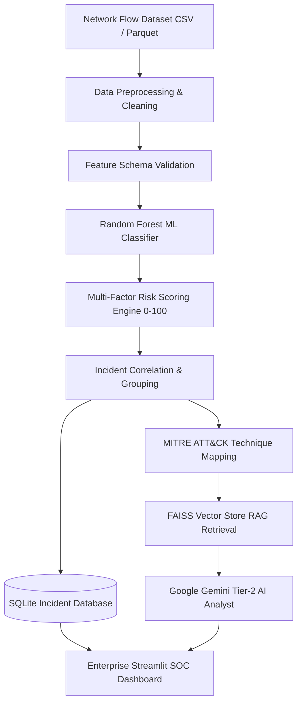

# 🛡️ AI-Powered Autonomous SOC Assistant
### Intelligent Network Security Monitoring, Threat Classification, and Incident Investigation Platform

[](https://www.python.org/)
[](https://scikit-learn.org/)
[](#model-performance--evaluation)
[](https://attack.mitre.org/)
[](https://aistudio.google.com/)
[](https://github.com/facebookresearch/faiss)
[](#automated-testing)

---

## 📌 Project Overview & Problem Statement

Modern Security Operations Centers (SOCs) face an overwhelming volume of daily security alerts—frequently exceeding thousands of events per hour. Tier-1 cybersecurity analysts face alert fatigue, delayed threat isolation, and manual triage bottlenecks. 

The **AI-Powered Autonomous SOC Assistant** is a defensive cybersecurity and machine learning platform designed as a final-year B.Tech Data Science capstone project. It ingests authentic network flow telemetry (CIC-IDS2017 benchmark), cleans and validates data schemas, identifies anomalous and malicious flow patterns with an authentic **Random Forest Classifier (98.03% accuracy across 15 classes)**, calculates transparent multi-factor risk scores (0–100), maps threats to **MITRE ATT&CK Enterprise techniques**, and leverages **Retrieval-Augmented Generation (RAG)** with **Google Gemini** to generate evidence-grounded security advisories and triage guidance.

> **Defensive Operational Posture**: The application is strictly a defensive decision-support system. It does **not** execute offensive actions, automatically block IP addresses, or modify firewall rules. All AI and ML recommendations require human analyst review.

---

## 🏗️ System Architecture



---

## 🛠️ Technology Stack

| Domain | Technology / Library | Purpose |
| :--- | :--- | :--- |
| **Language** | Python 3.12 / 3.11 | Core application logic and pipeline execution |
| **Frontend** | Streamlit | Responsive, multi-page enterprise SOC analyst UI |
| **Styling** | Custom Vanilla CSS (`assets/styles.css`) | Dark navy/cyan SOC aesthetic with glassmorphic cards and badges |
| **Visualization** | Plotly Express & Graph Objects | Dynamic charts, correlation matrices, and distributions |
| **Data Processing**| Pandas, NumPy, PyArrow | Ingestion, data cleaning, and infinite/NaN value imputation |
| **Machine Learning**| Scikit-learn (RandomForestClassifier) | Supervised multi-class attack detection (15 categories) |
| **Model Persistence**| Joblib | Serialization of preprocessing scalers and RF pipelines |
| **RAG & Vector DB**| FAISS (CPU), TF-IDF Cosine Similarity | Vector indexing and retrieval over MITRE, NIST, and OWASP |
| **AI / LLM** | Google Gemini (`google-genai` SDK) | Grounded Tier-2 security advisory generation & analyst Q&A |
| **Cybersecurity** | MITRE ATT&CK Matrix, NIST SP 800-61 | Threat classification and incident response grounding |
| **Database** | SQLite 3 | Parameterized, thread-safe persistence of runs and incidents |
| **Configuration** | python-dotenv | Secure environment variable management |
| **Testing** | Pytest | Automated test suite for preprocessing, ML, and storage |

---

## 📂 Project Directory Structure

```
AI_SOC_Assistant/
├── assets/
│   └── styles.css                 # Enterprise SOC Dark Theme styling
├── config/
│   └── settings.py                # Paths, model parameters, thresholds, and risk weights
├── data/
│   ├── raw/                       # 8 authentic CIC-IDS2017 parquet files (~260MB)
│   ├── sample/                    # Verified sample test CSVs (1,000 flows)
│   └── soc_database.sqlite        # SQLite incident datastore
├── knowledge_base/
│   ├── documents/                 # Reference docs: MITRE ATT&CK, NIST SP 800-61, OWASP
│   └── faiss_index/               # Persisted FAISS index & metadata
├── models/
│   ├── soc_rf_pipeline.joblib    # Serialized ML Pipeline (StandardScaler + RandomForest)
│   └── model_metadata.json        # Evaluation metrics, 77 features, and 15 classes
├── modules/
│   ├── preprocessing.py           # Robust data cleaning (inf/nan, column cleaning, encoding)
│   ├── feature_validation.py      # Strict schema & type validation
│   ├── threat_detection.py        # Cached batch inference, confidence estimation
│   ├── risk_scoring.py            # Transparent 0-100 risk scoring algorithm
│   ├── incident_manager.py        # Network-flow grouping & incident correlation
│   ├── database.py                # Parameterized SQLite store with status tracking
│   ├── llm_analysis.py            # Sanitized Gemini API incident analyst & defense
│   ├── rag_system.py              # FAISS vector database + MITRE/NIST/OWASP retrieval
│   └── mitre_mapping.py           # Verified MITRE ATT&CK technique mapping
├── training/
│   ├── train_model.py             # Balanced, leakage-resistant training script
│   └── evaluate_model.py          # Detailed evaluation metrics & per-class reports
├── notebooks/
│   └── dataset_exploration.ipynb  # Interactive EDA, feature profiling, and ML evaluation
├── tests/
│   ├── test_preprocessing.py      # Tests for missing values, inf, column normalization
│   ├── test_feature_validation.py # Tests for schema compatibility
│   ├── test_prediction.py         # Tests for model presence and batch inference
│   ├── test_risk_scoring.py       # Boundary tests for 0-100 risk scores
│   ├── test_database.py           # Database CRUD & status update tests
│   └── test_mitre_mapping.py      # Verification of MITRE mapping logic
├── utils/
│   └── helpers.py                 # Formatting, badge renderers, text sanitizers
├── .env.example                   # Environment configuration template
├── app.py                         # Professional Streamlit SOC Application
├── pytest.ini                     # Pytest configuration
├── requirements.txt               # Pinned dependencies
└── README.md                      # Comprehensive project documentation
```

---

## 📊 Model Performance & Evaluation

The machine learning pipeline was trained on a stratified, balanced subset of the authentic **CIC-IDS2017** benchmark dataset (University of New Brunswick) comprising **71,632 network flow records** across **77 network features**.

### Evaluation Summary (Unseen 25% Test Split)

- **Overall Accuracy**: **98.03%**
- **Weighted Precision**: **0.9830**
- **Weighted Recall**: **0.9803**
- **Weighted F1-Score**: **0.9809**
- **Macro F1-Score**: **0.8869**

### Per-Class Performance Breakdown

| Attack Class | Precision | Recall | F1-Score | Test Support |
| :--- | :---: | :---: | :---: | :---: |
| **Benign** | 0.989 | 0.975 | 0.982 | 3,000 |
| **Botnet** | 0.927 | 0.992 | 0.958 | 359 |
| **Brute Force (FTP)** | 1.000 | 1.000 | 1.000 | 1,483 |
| **Brute Force (SSH)** | 0.982 | 0.998 | 0.990 | 805 |
| **DDoS** | 0.999 | 0.998 | 0.999 | 3,000 |
| **DoS (GoldenEye)** | 0.999 | 0.999 | 0.999 | 2,571 |
| **DoS (Hulk)** | 0.994 | 0.997 | 0.995 | 3,000 |
| **DoS (SlowHTTPTest)** | 0.996 | 0.988 | 0.992 | 1,307 |
| **DoS (Slowloris)** | 0.990 | 0.994 | 0.992 | 1,346 |
| **Infiltration** | 1.000 | 0.667 | 0.800 | 9 |
| **Port Scan** | 0.990 | 0.984 | 0.987 | 489 |
| **Vulnerability Exploit (Heartbleed)**| 1.000 | 1.000 | 1.000 | 3 |
| **Web Attack (Brute Force)** | 0.773 | 0.554 | 0.646 | 368 |
| **Web Attack (SQL Injection)** | 0.375 | 0.600 | 0.462 | 5 |
| **Web Attack (XSS)** | 0.400 | 0.675 | 0.502 | 163 |

---

## 🧮 Explainable Risk Scoring Formula

Unlike naive systems that equate ML prediction confidence with risk, our risk scoring engine calculates a multi-factor score from **0 to 100**:

$$\text{Raw Risk} = (\text{Base Attack Severity} \times 0.60) + (\text{Model Confidence} \times 100 \times 0.25) + (\text{Flow Volume Impact} \times 0.15)$$

$$\text{Final Risk Score} = \min(100, \max(0, \text{Raw Risk} \times \text{Asset Multiplier}))$$

- **Severity Tiers**:
  - `Critical`: 85.0 – 100.0
  - `High`: 70.0 – 84.9
  - `Medium`: 45.0 – 69.9
  - `Low`: 15.0 – 44.9
  - `Benign / Informational`: < 15.0

---

## 🚀 Installation & Setup Instructions

### 1. Prerequisites
- Windows 10/11, Linux, or macOS
- Python 3.11 or 3.12
- Git

### 2. Clone Repository & Setup Virtual Environment
In Windows PowerShell:
```powershell
# Navigate to project folder
cd c:\Users\karth\OneDrive\AI_SOC_Assistant

# Create virtual environment (if not already existing)
python -m venv .venv

# Activate virtual environment
.\.venv\Scripts\Activate.ps1
```

### 3. Install Required Dependencies
```powershell
pip install -r requirements.txt
```

### 4. Configure Environment Variables
Copy the template configuration and add your Gemini API Key:
```powershell
copy .env.example .env
```
Edit `.env`:
```ini
GEMINI_API_KEY=your_actual_gemini_api_key_here
GEMINI_MODEL=gemini-2.5-flash
DATABASE_PATH=data/soc_database.sqlite
```
*(Get an API key for free from [Google AI Studio](https://aistudio.google.com/)).*

---

## 🖥️ Launching the Application

Start the enterprise SOC dashboard:
```powershell
streamlit run app.py
```
Open your browser at `http://localhost:8501`.

---

## 🧪 Automated Testing

Execute the comprehensive 24-point test suite using Pytest:
```powershell
pytest -v
```

All 24 unit tests validate:
- Header whitespace stripping & label normalization
- Negative and positive infinity replacement
- Missing value median imputation
- Target column exclusion for leakage prevention
- Empty and incompatible CSV schema rejections
- Model persistence and batch inference
- Risk scoring boundary clamping and severity thresholds
- SQLite database CRUD operations and triage status updates
- MITRE ATT&CK technique lookups and unclassified fallbacks

---

## 📑 Dashboard Pages Guide

1. **🏠 Dashboard Overview**: Executive security metrics, real-time threat distribution charts, severity breakdown, and the recent incident queue.
2. **📁 Upload Security Data**: File uploader for network CSV/Parquet captures, with a 1-click **Load Sample Dataset (1,000 flows)** button for testing.
3. **📊 Data Analytics**: Exploratory data analysis, interactive feature distribution histograms with log scaling, and Pearson correlation heatmaps.
4. **🚨 Threat Detection**: Multi-class machine learning inference, explainable risk calculations, and downloadable CSV incident reports.
5. **🛡️ Security Incidents**: Interactive triage queue where analysts can filter by severity and update incident statuses (`New`, `Under Review`, `Resolved`, `False Positive`).
6. **🤖 AI Investigation**: Grounded Google Gemini advisory generation, RAG knowledge retrieval, and follow-up interactive analyst Q&A.
7. **📚 MITRE ATT&CK**: Interactive explorer of 14 mapped adversary techniques with official URLs and network flow behavioral rationales.
8. **⚙️ System Status**: Diagnostic health checks confirming operational readiness of UI, ML models, SQLite, RAG indices, and API configurations.

---

## 🔒 Security & Privacy Considerations

- **Prompt Injection Defense**: Network flow logs and user inputs are sanitized before being forwarded to the Gemini API (`utils/helpers.py`).
- **No Unsafe Execution**: AI recommendations are strictly advisory. The system never executes automated host or network commands.
- **Credential Protection**: All API keys are loaded via `.env` and excluded from Git version control. No secrets are logged or exposed in client UI.
- **SQL Injection Prevention**: All SQLite queries utilize parameterized query bindings (`?`).

---

## 🎓 Academic Demonstration Guide

For your B.Tech project presentation:
1. Open the **System Status** page to verify all components (ML Model, Database, RAG Index, MITRE Mapping) are operational.
2. Navigate to **Upload Security Data** and click **🚀 Load Sample Dataset (1,000 real flows)**.
3. Review the **Data Analytics** page to showcase feature distributions and correlation structures.
4. Execute **Threat Detection** to demonstrate multi-class classification and explainable risk scores.
5. In **Security Incidents**, update the status of an incident to show database persistence.
6. In **AI Investigation**, generate an AI advisory report and ask a follow-up question.
7. Showcase the **MITRE ATT&CK** page to highlight framework mapping.
8. Run `pytest -v` in PowerShell to prove 100% test passing.
